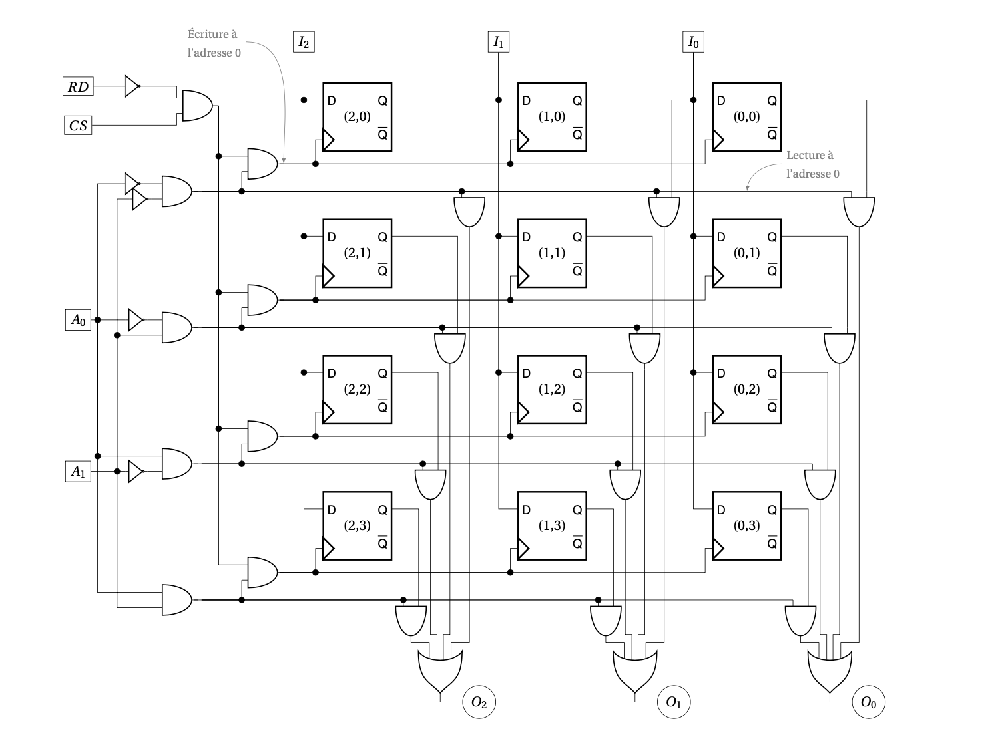
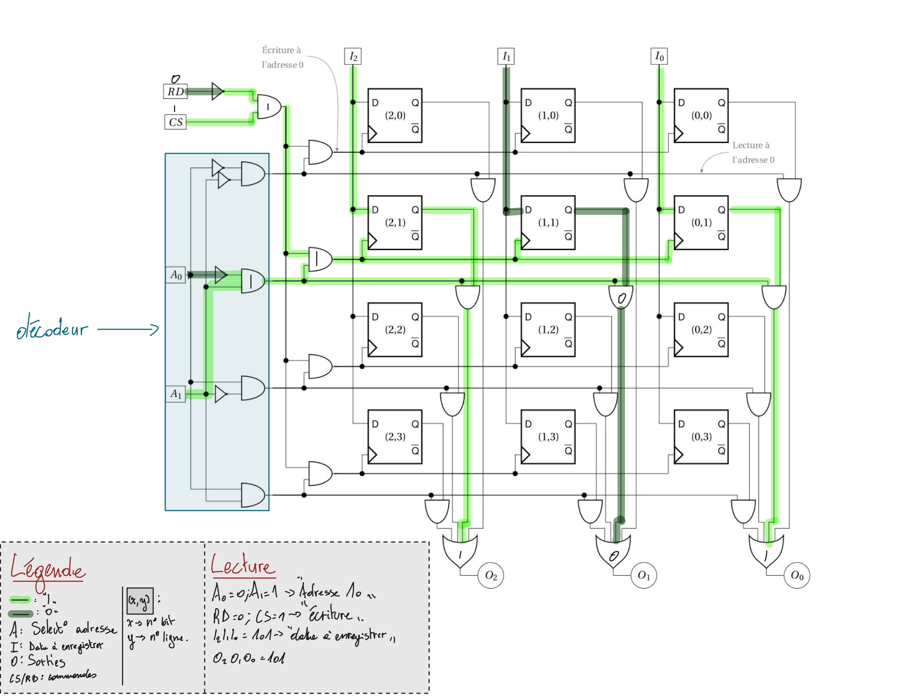

# Circuit de mémoire complet

La mémoire est réalisée à l’aide de **flip-flops**. Elle est organisée en **cases de taille fixe**, chacune identifiée par une **adresse**. On peut lire ou écrire une case à la fois.

## Exemple du cours

On construit une mémoire de **4 cases de 3 bits** :

- **4 adresses**, codées sur **2 bits**.
- **3 bits par case**, soit **3 flip-flops par ligne**.
- **12 bits de mémoire** au total.

## Circuit original

*Figure 5.5.1 — Circuit d’une mémoire de 4 mots de 3 bits.*

## Circuit annoté

*Figure 5.5.2 — Écriture du mot 101 dans la deuxième ligne sélectionnée (A0 = 0, A1 = 1 ; RD = 0, CS = 1). Les couleurs indiquent les niveaux logiques des signaux.*

