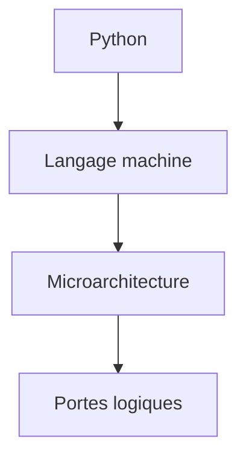

# Microarchitecture

## Le langage machine étudié

On utilise l’**IJVM**, un langage machine pédagogique à pile.

[Suite → Le langage machine IJVM](6.1%20-%20Le%20langage%20machine%20IJVM.md)

## Suite du chapitre

- [Le chemin des données du MIC-1](6.2%20-%20Le%20chemin%20des%20donn%C3%A9es%20du%20MIC-1.md)
- [Les micro-instructions](6.3%20-%20Les%20micro-instructions.md)
