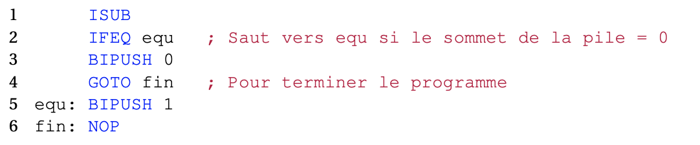
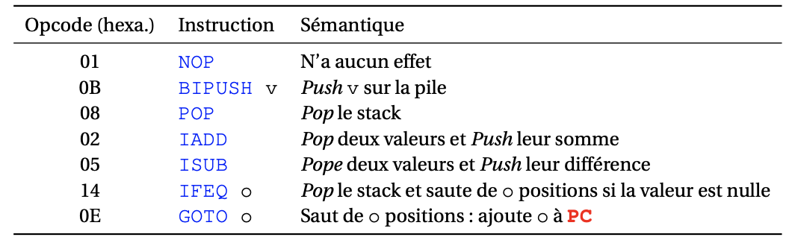
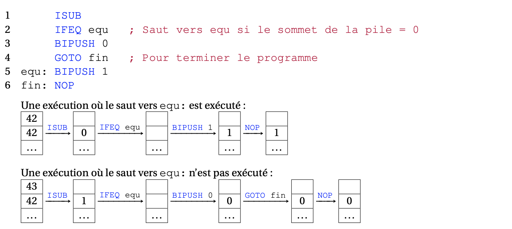

# Le langage machine IJVM

Les instructions manipulent les données au sommet d’une **pile** : dernier entré, premier sorti.

## Push et pop

Le sommet est placé **à droite** dans les tableaux.

| Opération | Pile |
| :--- | :--- |
| État initial | `[5, 7]` |
| `BIPUSH 8` | `[5, 7, 8]` |
| `POP` | `[5, 7]` |

## Addition
`IADD` retire les deux valeurs au sommet et les remplace par leur somme.

| Opération    | Pile      |
| :----------- | :-------- |
| État initial | Vide      |
| `BIPUSH 7`   | `[7]`     |
| `BIPUSH 12`  | `[7, 12]` |
| `IADD`       | `[19]`    |

## Sauts : GOTO et IFEQ

- **`GOTO`** : poursuit l’exécution à l’endroit indiqué.
- **`IFEQ`** : retire le sommet et effectue le saut si cette valeur vaut **0**. Sinon, poursuit à l’instruction suivante.

### Exemple

*Figure 6.1.1 — Comparaison de deux valeurs avec IFEQ et GOTO : les deux chemins d’exécution.*

## Opérations possibles
 

*Figure 6.1.2 — Instructions IJVM du cours : opcodes et sémantique.*

## Représentation en hexadécimal

Une instruction est représentée par un **opcode sur 1 octet**, suivi d’un **éventuel opérande**.

Pour les sauts, le décalage se calcule depuis **l’adresse de l’opcode du saut**.

### Encodage de l’exemple

*Figure 6.1.3 — Programme de comparaison à encoder en hexadécimal.*

| Adresse (décimale) | Instruction | Octets en hexadécimal |
| :---: | :--- | :--- |
| 0 | `ISUB` | `05` |
| 1 | `IFEQ equ` | `14 00 08` |
| 4 | `BIPUSH 0` | `0B 00` |
| 6 | `GOTO fin` | `0E 00 05` |
| 9 | `equ: BIPUSH 1` | `0B 01` |
| 11 | `fin: NOP` | `01` |

Décalages : **IFEQ : 9 − 1 = 8** ; **GOTO : 11 − 6 = 5**.

---

[← Microarchitecture](6%20-%20Microarchitecture.md)

[Suite → Le chemin des données du MIC-1](6.2%20-%20Le%20chemin%20des%20donn%C3%A9es%20du%20MIC-1.md)
