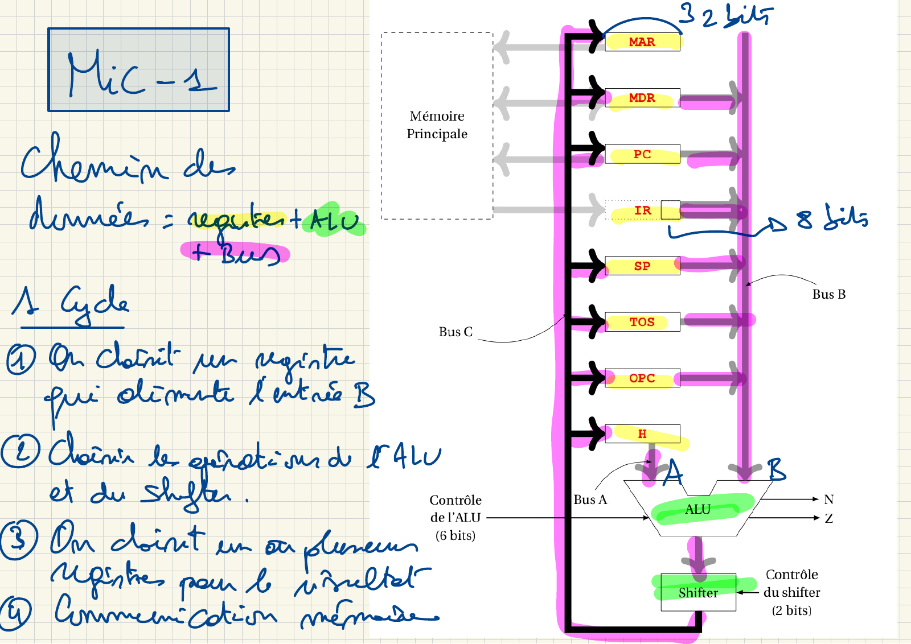

# Le chemin des données du MIC-1

Le **MIC-1** réalise les opérations à l’aide de **registres**, d’une **ALU** et de **bus** qui transportent les données.

## Schéma du cours

*Figure 6.2.1 — Chemin des données du MIC-1 et étapes d’un cycle, annotés au cours du 9 novembre.*

## Registres utilisés

| Registre | Rôle dans les exemples |
| :--- | :--- |
| `MAR` | Adresse pour lire ou écrire une donnée en mémoire. |
| `MDR` | Donnée lue ou à écrire en mémoire. |
| `PC` | Adresse utilisée pour lire le programme. |
| `IR` | Octet lu dans le programme : opcode ou opérande. |
| `SP` | Adresse du sommet de la pile. |
| `TOS` | Copie de la valeur au sommet de la pile. |
| `H` | Valeur qui alimente l’entrée A de l’ALU ; sert aussi à reconstruire le décalage d’un saut. |

Les registres du schéma font **32 bits**, sauf `IR`, qui fait **8 bits**. `OPC` apparaît sur le schéma, mais son utilisation n’est pas encore détaillée dans ces notes.

## Un cycle

1. Choisir **un registre** pour alimenter le **bus B**, puis l’entrée B de l’ALU.
2. Choisir les opérations de l’**ALU** et du **shifter** (circuit de décalage). L’entrée A provient de `H`.
3. Envoyer le résultat par le **bus C** vers **un ou plusieurs registres**.
4. Lancer, si nécessaire, une communication avec la mémoire.

## Communication avec la mémoire

| Commande | Adresse | Donnée |
| :--- | :--- | :--- |
| `rd` | Dans `MAR` | La donnée lue arrive dans `MDR`. |
| `fetch` | Dans `PC` | L’octet du programme arrive dans `IR`. |
| `wr` | Dans `MAR` | Le contenu de `MDR` est écrit en mémoire. |

**La lecture n’est pas immédiate** : lancée à la fin d’un cycle, elle se termine à la fin du suivant. La valeur peut donc être utilisée au **troisième cycle**.

---

[← Le langage machine IJVM](6.1%20-%20Le%20langage%20machine%20IJVM.md) · [Suite → Les micro-instructions](6.3%20-%20Les%20micro-instructions.md)
